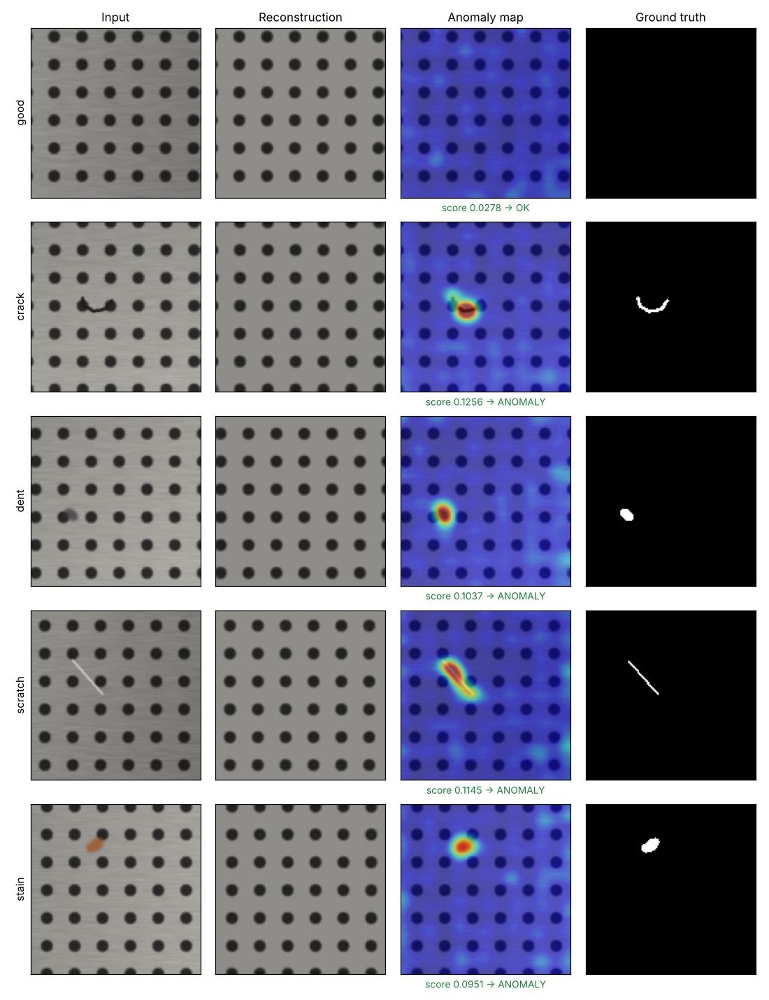
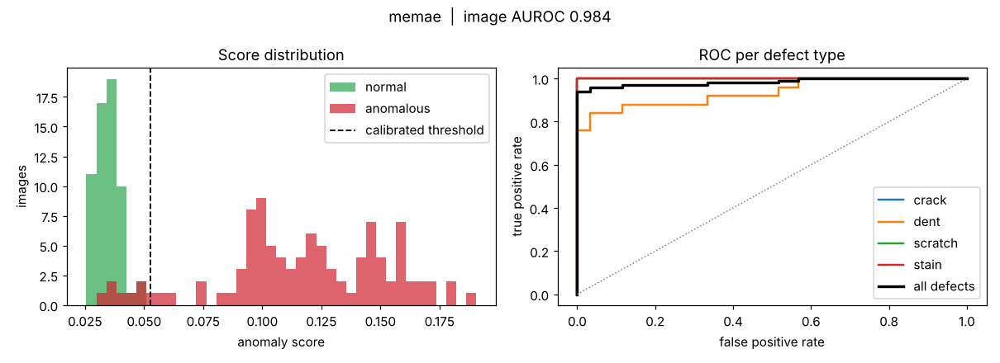
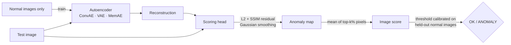

<div align="center">

# Autoencoder Anomaly Detection for Visual Inspection

**Unsupervised defect detection and localisation, from training to a production REST API.**

Train on *good* parts only. Detect and localise scratches, cracks, dents and stains it has never seen.

[](https://github.com/eslamelmenyawy/autoencoder-anomaly-detection/actions/workflows/ci.yml)




<sub>MemAE on the held-out test set: input · reconstruction · anomaly heatmap · ground-truth mask</sub>

</div>

---

## Why this project

On a production line, defects are rare and every one looks different, so collecting and labelling enough defect images for a supervised detector is slow and expensive. Normal parts, on the other hand, are plentiful.

An **autoencoder trained only on normal images** learns to reconstruct what "good" looks like. When it sees a defect, it cannot reconstruct it, and the **reconstruction error becomes a pixel-level anomaly map**. No defect labels are needed for training.

This repository is a complete, production-style implementation of that idea:

- **Three architectures** behind one interface: Convolutional AE, Variational AE and Memory-augmented AE (MemAE)
- **SSIM + L2 anomaly maps** with Gaussian smoothing and top-k image scoring
- **Threshold calibration on held-out normal images only** (no test-set leakage)
- **Full evaluation**: image AUROC, pixel AUROC, AP, per-defect AUROC, F1, latency, plus report figures
- **Single-graph ONNX export** (model **and** scoring head), verified numerically against PyTorch, with optional OpenVINO IR
- **Deployment without PyTorch**: ONNX Runtime predictor, FastAPI service and a slim Docker image
- **Engineering**: typed YAML configs, CLI, 18 tests (unit + end-to-end), CI on Python 3.10–3.12, Ruff

---

## Results

All numbers below were produced by this code on the included synthetic perforated-metal dataset: 400 normal training images, 160 test images (60 normal, 100 defective across 4 defect types), 128×128 input, 40 epochs, trained on a 2-core cloud CPU (about 20 minutes per model).

| Model | Params | Image AUROC | Image AP | Pixel AUROC | F1 @ calibrated threshold | False alarms (of 60 good) | Latency (CPU) |
|---|---|---|---|---|---|---|---|
| ConvAE | 6.6M | **0.985** | **0.993** | **0.993** | 0.964 | **0** | 35.7 ms |
| VAE | 2.4M | **0.985** | **0.993** | **0.993** | **0.975** | 1 | 33.6 ms |
| MemAE | 2.5M | 0.984 | 0.992 | **0.993** | 0.964 | **0** | **26.7 ms** |

<sub>Image AUROC / AP: image-level detection. Pixel AUROC: defect localisation against ground-truth masks. F1 uses the threshold calibrated on validation **normal** images only, so it reflects real deployment behaviour. Latency: batch of 1, PyTorch, 2-core cloud CPU — expect far lower on a GPU or with OpenVINO.</sub>

**Per-defect image AUROC**

| Model | Scratch | Crack | Stain | Dent |
|---|---|---|---|---|
| ConvAE | 1.000 | 1.000 | 1.000 | 0.939 |
| VAE | 1.000 | 1.000 | 1.000 | 0.938 |
| MemAE | 1.000 | 1.000 | 1.000 | 0.936 |

<p align="center">
  
</p>

**What the results say**

- **All three detect and localise every scratch, crack and stain** (AUROC 1.000), with pixel AUROC of 0.993: the heatmaps land on the defect, not just the right image.
- **Dents are the hard case** (AUROC ≈ 0.94). A dark dent that overlaps one of the plate's dark holes is almost indistinguishable from the normal pattern; every one of the 4–7 missed defects is a dent.
- **The calibrated threshold transfers to unseen data:** chosen from normal validation images only, it gives 0 false alarms for ConvAE and MemAE, and F1 within 0.01 of the best possible (oracle) threshold.
- **MemAE and VAE reach the same accuracy with ~2.7× fewer parameters** than ConvAE, because their spatial latents replace ConvAE's large fully-connected bottleneck.
- On this clean synthetic surface the three architectures converge to similar accuracy; their differences are expected to show on harder real textures, which is the next benchmark on the roadmap.

> The synthetic dataset makes the whole pipeline reproducible in minutes with no downloads. For benchmarking on real data, point the same configs at [MVTec AD](https://www.mvtec.com/company/research/datasets/mvtec-ad) — see [Using your own data](#using-your-own-data).

---

## How it works



| Model | Idea | Why it helps |
|---|---|---|
| **ConvAE** | Conv encoder → dense 128-d bottleneck → conv decoder | A tight global bottleneck can only encode "normal" structure |
| **VAE** | Gaussian posterior at every position of a 16 × 8 × 8 latent grid, KL-regularised (β = 0.01); posterior mean at inference | Compact, smooth latent; deterministic scores at test time |
| **MemAE** ([Gong et al., ICCV 2019](https://arxiv.org/abs/1904.02639)) | Every latent position is rebuilt from a sparse, cosine-addressed mix of 100 learned *normal* memory slots | Stops the AE from "generalising too well" and reconstructing defects |

**Training details that matter**

- **SSIM warm-up.** Training starts with pure MSE and linearly ramps in SSIM over the first 10 epochs. With SSIM in the loss from the start, the models collapsed to predicting the mean image (SSIM has weak gradients from that state); the warm-up fixed it.
- **Avoiding collapse in MemAE and VAE.** A first MemAE with dot-product addressing on one global vector saturated its softmax onto a single slot and output a constant image (AUROC 0.53). Cosine addressing on every spatial position, as in the original paper, fixed it. The dense VAE likewise collapsed to the mean image; a spatial posterior initialised near-deterministic (σ ≈ 0.05) with β = 0.01 trains reliably.
- **Checkpoint selection** uses validation loss on held-out normal images; early stopping is disabled during warm-up.
- **The scoring head is an `nn.Module`**, so the anomaly map, smoothing and top-k score are exported inside the ONNX graph. Deployment code never re-implements scoring, so there's no train/serve skew.

---

## Quick start

```bash
git clone https://github.com/eslamelmenyawy/autoencoder-anomaly-detection.git
cd autoencoder-anomaly-detection

python -m venv .venv && source .venv/bin/activate     # Windows: .venv\Scripts\activate
pip install torch --index-url https://download.pytorch.org/whl/cu121   # or /cpu
pip install -e ".[train,serve,dev]"
```

```bash
aead synth --out data/synthetic                                  # 1. generate data (~10 s)
aead train --config configs/memae.yaml --evaluate                # 2. train + evaluate
aead export --checkpoint runs/memae/best.pt                      # 3. ONNX (+ --format openvino)
aead predict --model runs/memae/export/model.onnx \
             --source data/synthetic/test/crack --out predictions # 4. batch inference + heatmaps
aead serve --model runs/memae/export/model.onnx                   # 5. REST API on :8000
```

Or train, evaluate and export all three models with `make train-all`.

### REST API

```bash
curl -F "file=@data/synthetic/test/scratch/000.png" "http://localhost:8000/predict?heatmap=true"
```

```json
{
  "filename": "000.png",
  "score": 0.114479,
  "threshold": 0.052829,
  "is_anomaly": true,
  "label": "ANOMALY",
  "latency_ms": 20.91,
  "heatmap_png_base64": "iVBORw0KGgo..."
}
```

Interactive docs are at `http://localhost:8000/docs`. `GET /health` and `GET /model` are available for orchestration.

### Docker (inference only, no PyTorch)

```bash
aead export --checkpoint runs/memae/best.pt
docker build -t aead-api --build-arg MODEL_DIR=runs/memae/export .
docker run -p 8000:8000 aead-api
```

---

## Using your own data

Any dataset in the **MVTec AD layout** works without code changes:

```
your_dataset/
├── train/good/             ← normal images only (training)
├── test/good/              ← normal test images
├── test/<defect_type>/     ← defective test images
└── ground_truth/<defect_type>/<image>_mask.png   ← optional, enables pixel AUROC
```

```bash
aead train --config configs/memae.yaml --data path/to/your_dataset --name my_product --evaluate
```

8-bit and 16-bit images (common with industrial cameras) are both supported. See the full guide, with a tuning table for real data, in [docs/CUSTOM_DATASET.md](docs/CUSTOM_DATASET.md). Adjust `image_size`, `channels` and `latent_dim` in the YAML for larger inputs.

---

## Configuration

Every run is driven by a YAML file (see [`configs/`](configs)); unknown keys raise an error, so typos never fail silently.

| Section | Key | Default | Meaning |
|---|---|---|---|
| `model` | `name` | `conv_ae` | `conv_ae`, `vae` or `memae` |
| `model` | `latent_dim` | `128` | ConvAE bottleneck size / MemAE memory-item size (smaller = stronger anomaly signal, blurrier reconstructions) |
| `model` | `kl_weight` | `0.01` | VAE β (larger values cause posterior collapse) |
| `model` | `memory_size` | `100` | MemAE memory slots |
| `train` | `ssim_weight` / `ssim_warmup_epochs` | `0.5` / `10` | SSIM share of the loss and its warm-up |
| `scoring` | `ssim_weight` | `0.5` | 0 = pure L2 residual, 1 = pure SSIM residual |
| `scoring` | `blur_sigma` | `4.0` | Gaussian smoothing of the anomaly map |
| `scoring` | `topk_ratio` | `0.01` | Image score = mean of the top 1% anomaly-map pixels |
| `scoring` | `threshold_percentile` | `99.0` | Decision threshold percentile on held-out normal scores |

---

## Project structure

```
autoencoder-anomaly-detection/
├── src/aead/
│   ├── models/          # ConvAE, VAE, MemAE (+ shared encoder/decoder)
│   ├── scoring.py       # SSIM, anomaly maps, top-k scoring (ONNX-exportable)
│   ├── engine.py        # training loop, SSIM warm-up, calibration, checkpoints
│   ├── evaluate.py      # metrics, latency and report figures
│   ├── metrics.py       # image/pixel AUROC, AP, F1, per-defect AUROC
│   ├── export.py        # ONNX (+ OpenVINO) export with numerical verification
│   ├── inference.py     # unified predictor: .pt / .onnx / .xml (no torch for ONNX)
│   ├── api.py           # FastAPI service
│   ├── synthetic.py     # synthetic inspection dataset with pixel masks
│   ├── data.py · datasets.py · config.py · visualize.py · cli.py
├── configs/             # conv_ae.yaml · vae.yaml · memae.yaml
├── tests/               # unit + end-to-end tests (train → export → API)
├── docs/images/         # figures used in this README
├── Dockerfile · Makefile · pyproject.toml
└── .github/workflows/ci.yml
```

---

## Testing

```bash
pytest          # 18 tests, ~40 s on CPU
ruff check src tests
```

The end-to-end tests train a tiny model, evaluate it, export to ONNX, check that ONNX matches PyTorch, check that the ONNX path never imports PyTorch, and call the REST API.

---

## Roadmap

- [ ] Benchmark on MVTec AD categories and add the results table
- [ ] NVIDIA Jetson deployment: ONNX → TensorRT FP16/INT8 engine with on-device latency benchmarks
- [ ] INT8 post-training quantisation with OpenVINO NNCF and latency comparison
- [ ] Feature-reconstruction variant on a pretrained backbone (closer to PatchCore-level accuracy)
- [ ] Industrial camera input (Basler / GenICam) for live line inspection

## References

- Gong et al., *Memorizing Normality to Detect Anomaly: Memory-augmented Deep Autoencoder*, ICCV 2019 — [arXiv:1904.02639](https://arxiv.org/abs/1904.02639)
- Bergmann et al., *Improving Unsupervised Defect Segmentation by Applying Structural Similarity to Autoencoders*, VISAPP 2019 — [arXiv:1807.02011](https://arxiv.org/abs/1807.02011)
- Kingma & Welling, *Auto-Encoding Variational Bayes*, ICLR 2014 — [arXiv:1312.6114](https://arxiv.org/abs/1312.6114)
- Bergmann et al., *MVTec AD — A Comprehensive Real-World Dataset for Unsupervised Anomaly Detection*, CVPR 2019

---

<div align="center">

Built by **Sam (Islam) Elmenyawy** · AI/ML Engineer, Computer Vision & Industrial Inspection<br/>
[LinkedIn](https://www.linkedin.com/in/islam-ahmed-00188015a/) · [GitHub](https://github.com/eslamelmenyawy)

</div>
